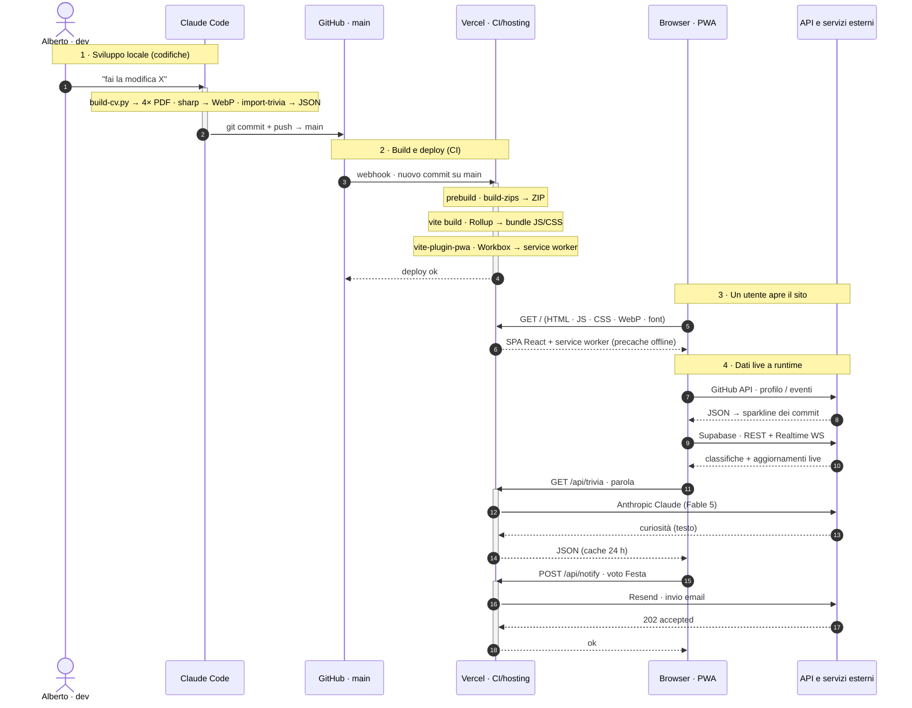

<div align="center">

# Alberto Pecchini — Portfolio & Personal Hub

**SPA React/TypeScript** — un portfolio personale che fa da _hub_ a un sito multi-pagina
(bio, approfondimenti, un gioco-quiz, strumenti e sezioni evento), servito **una pagina
= un sottodominio**, tradotto al volo in **4 lingue** e vestito in palette **Ubuntu orange**.

<!-- ─────────────  METRICHE LIVE (shields.io → GitHub API, auto-aggiornanti)  ───────────── -->

[](https://github.com/albertoxpecchini/AP/commits/main)
[](https://github.com/albertoxpecchini/AP/pulse)
[](https://github.com/albertoxpecchini/AP)
[](https://github.com/albertoxpecchini/AP)
[](https://github.com/albertoxpecchini/AP)
[](https://github.com/albertoxpecchini/AP)
[](https://github.com/albertoxpecchini/AP/tree/main/src)
[](#-licenza)

<!-- ─────────────  STACK (badge logo statici, allineati al package.json)  ───────────── -->

[](https://react.dev)
[](https://www.typescriptlang.org)
[](https://vite.dev)
[](https://tailwindcss.com)
[](https://reactrouter.com)
[](https://motion.dev)
[](https://threejs.org)
[](https://vite-pwa-org.netlify.app/)
[](https://supabase.com)
[](https://www.anthropic.com)
[](https://vercel.com)

🔗 **Live:** [albertopecchini.it](https://albertopecchini.it) · **Repo:** [albertoxpecchini/AP](https://github.com/albertoxpecchini/AP) · **Autore:** [@albertoxpecchini](https://github.com/albertoxpecchini)

</div>

---

## 📊 Il progetto in numeri

> I badge di metrica derivano in tempo reale dall'API GitHub: si ricalcolano a ogni `git push`, senza manutenzione.

| Dominio | Valore | Dettaglio |
| :--- | :--- | :--- |
| **Codebase** | **~24,9k LOC** in `src/` | 34 `.tsx` · 29 `.ts` · 10 `.css` |
| **Dipendenze** | **12 runtime** + 9 dev | niente framework pesanti, tutto essenziale |
| **Pagine** | **11 rotte** | 1 hub + 10 pagine `React.lazy`, code-split per rotta |
| **Lingue UI** | **4** — IT · EN · FR · DE | motore i18n che traduce il DOM live |
| **Trivia — quiz** | **1000 domande** su 40 capitoli | 400 multipla · 400 vero/falso · 200 aperta |
| **Serverless** | **7 funzioni** in `api/` | trivia · notify · festa-rsvp · sponsor · ig-stats · d · cron |
| **Cronologia** | **331 commit** dal 2026-05-24 | 162 `feat` · 78 `fix` · 25 `style` · 15 `chore` · 6 `refactor` |

[](https://github.com/albertoxpecchini/AP/stargazers)
[](https://github.com/albertoxpecchini/AP/network/members)

---

## 🧭 Architettura a sottodomini — le pagine

Ogni pagina è un sotto-applicativo autonomo: **rotta dedicata**, **_lazy chunk_ indipendente**,
stile inline autosufficiente. In produzione vale la regola **una pagina = un sottodominio**
(`bio.albertopecchini.it`, `trivia.albertopecchini.it`, …); in dev/preview resta una SPA a
path su un'unica origine. La logica sta in [`src/app/site/nav.tsx`](src/app/site/nav.tsx).

| Rotta | Sottodominio | Pagina | Cosa fa |
| :--- | :--- | :--- | :--- |
| `/` | `www` | **Home / hub** | Vetrina progetti, résumé, contatti — header e footer condivisi |
| `/bio` | `bio` | **Bio** | Pagina About «dark premium»: gallery + fatti essenziali |
| `/trivia` | `trivia` | **Trivia** | Quiz sulla storia dell'architettura — 1000 domande, leaderboard, curiosità AI |
| `/pcto` | `pcto` | **PCTO** | Alternanza scuola-lavoro (Caem Group) — timeline + racconto |
| `/me-stesso` | `me-stesso` | **Me stesso** | Presentazione personale (Esame di Stato 2026) |
| `/dubliners` | `dubliners` | **Dubliners** | Approfondimento «Gente di Dublino» (J. Joyce, 1914) |
| `/gattopardo` | `gattopardo` | **Gattopardo** | Approfondimento «Il Gattopardo» (Tomasi di Lampedusa, 1958) |
| `/festa` | `festa` | **Festa** | Inviti con token, RSVP e notifica email |
| `/archivio` | `archivio` | **Archivio** | Archivio progetti con riquadro README a lato |
| `/sostieni` | `sostieni` | **Sostieni** | Dati bonifico + libro firme dei donatori |
| `/instagram` | _(path)_ | **Instagram** | «Chi ti ha tolto il follow» — confronto di due liste, in locale |

---

## 🧠 Trivia — il modulo di punta

Pipeline **content-driven, zero-config**: i capitoli sono file Markdown in [`content/trivia/`](content/trivia/),
importati a build-time via `import.meta.glob(..., { query: '?raw', eager: true })` e parsati una sola
volta in [`parseTrivia.ts`](src/app/trivia/parseTrivia.ts). Aggiungere un capitolo = aggiungere un `.md`; nessun codice da toccare.

- **40 capitoli** ordinati dal campo `ordine:` (fallback alfabetico).
- **1000 domande** tipizzate: `multipla` (400), `vero-falso` (400), `aperta` (200).
- **Versionamento automatico** — `__TRIVIA_VERSION__` è iniettata da [`vite.config.ts`](vite.config.ts) come
  `1.<git rev-list --count HEAD -- src/app/trivia/>`: ogni deploy che tocca il modulo incrementa la _minor_ da solo.
- **Arricchimento AI** — l'endpoint serverless [`/api/trivia`](api/trivia.ts) interroga **Claude Fable 5**
  (`@anthropic-ai/sdk`) per curiosità contestuali; l'endpoint accetta solo richieste dal sito (origin check + rate-limit),
  così non è usabile come proxy AI gratuito.

---

## 🗂️ Struttura del repository

```
AP/
├── api/                      # 7 funzioni serverless Vercel (Node)
│   ├── trivia.ts             #   curiosità AI (Claude Fable 5)
│   ├── notify.ts             #   email dei voti Festa (Resend)
│   ├── festa-rsvp.ts         #   scrittura RSVP blindata (service role)
│   ├── sponsor.ts            #   firma libro donatori blindata
│   ├── ig-stats.ts           #   contatore confronti Instagram
│   ├── d.ts                  #   link tracciabili: apertura + redirect + autodelete
│   └── cron-cleanup.ts       #   pulizia giornaliera dei link scaduti (cron)
├── content/trivia/           # 40 capitoli .md → fonte unica delle domande Trivia
├── lib/serverSecurity.ts     # helper condivisi: origin check, rate-limit, diagnostica
├── public/                   # PDF (CV in 4 lingue + attestati), immagini, manifest PWA
├── scripts/                  # build-cv.py · build-zips.mjs · make-link.mjs · seed-*
├── src/
│   ├── app/
│   │   ├── App.tsx           # Home/hub + dispatcher di navigazione
│   │   ├── site/             # header, footer, nav, dati, progetti, modali
│   │   ├── trivia/           # gioco quiz + parser + API leaderboard/pagelle/progressi
│   │   ├── bio  pcto  me-stesso  dubliners  gattopardo  festa  archivio  sostieni  instagram
│   │   ├── i18n/             # motore di traduzione del DOM (IT · EN · FR · DE)
│   │   ├── theme/            # tema chiaro/scuro (manuale + sensore orario)
│   │   └── utils/            # keyboard guard, scroll lock, helper
│   ├── lib/                  # utilità trasversali (players, ecc.)
│   └── styles/               # theme.css (token palette) · tailwind · fonts · index
├── supabase/                 # schema .sql delle tabelle (scores, players, grades, link…)
└── vite.config.ts            # plugin React/Tailwind/PWA, asset resolver, versioning, dev-API
```

---

## 🔀 Come funziona — il giro dei dati (dal codice all'online)

Dalla **sorgente** (testi, dati, immagini, codice) agli **artefatti** prodotti dagli script di build
(PDF · ZIP · WebP · JSON · bundle · service worker), fino al **deploy** su Vercel e ai **dati live** che
il browser richiede a runtime (GitHub, Supabase, `/api`).

> Lo stesso schema è consultabile dal sito: **footer → «Come funziona»** (finestra interna).



| Servizio esterno | Uso | Dove |
| :--- | :--- | :--- |
| **GitHub API** (pubblica) | attività + sparkline dei commit nel footer | client |
| **Supabase** (REST + Realtime WS) | classifiche, pagelle, progressi, presenze, libro donatori (fallback `localStorage`) | client + serverless |
| **Anthropic Claude** (Fable 5) | curiosità del gioco Trivia | serverless `/api/trivia` |
| **Resend** | email dei voti Festa + avviso di apertura link tracciabili | serverless `/api/notify`, `/api/d` |

---

## 🧰 Stack tecnologico

| Layer | Tecnologie |
| :--- | :--- |
| **Core** | React 18.3 · TypeScript · Vite 6.3 |
| **Routing** | `react-router` 7 (BrowserRouter, route `lazy` + `Suspense`) |
| **Styling** | Tailwind CSS 4.1 · CSS custom properties · `tw-animate-css` |
| **Motion / 3D** | `motion` (Framer Motion 12) · `three` + `vanta` (sfondi animati) · `canvas-confetti` |
| **UI** | `lucide-react` + `react-icons` (icone) · `@radix-ui/react-context-menu` · `mermaid` (diagrammi) |
| **i18n** | motore proprietario che traduce il DOM in IT · EN · FR · DE |
| **PWA** | `vite-plugin-pwa` + Workbox (precache offline, auto-update) |
| **Backend** | Supabase via REST/Realtime (leaderboard, pagelle, progressi) · 7 funzioni serverless Vercel |
| **AI** | `@anthropic-ai/sdk` → Claude Fable 5 (curiosità Trivia) |
| **Insight** | `@vercel/speed-insights` (Core Web Vitals reali) |
| **Tooling** | script Python per i CV/favicon · `archiver` per gli ZIP d'archivio |

---

## 🔐 Sicurezza & privacy

Il sito è pensato per essere **a prova di abuso**, senza archiviare dati di terzi.

- **Solo l'email è pubblica** — niente telefono né WhatsApp sul sito o nel CV.
- **Scritture blindate** — RSVP, firme donatori e contatori non partono più diretti dal client verso
  Supabase: passano da un endpoint serverless con **origin check + rate-limit** e `INSERT` con
  **service role** (la `anon key` non può più iniettare dati fasulli).
- **Link tracciabili usa-e-getta** — [`/api/d`](api/d.ts) apre, conta e reindirizza; **autodelete a 7 giorni**
  (cron [`/api/cron-cleanup`](api/cron-cleanup.ts)), avviso via email alla **prima apertura**. La diagnostica del
  «chi» (IP, device, area) finisce **solo nell'email**, mai archiviata.
- **Header di sicurezza + CSP** definiti in [`vercel.json`](vercel.json).

---

## 🚀 Getting started

**Requisiti:** Node ≥ 18 (`npm`, `pnpm` o `yarn`).

```bash
git clone https://github.com/albertoxpecchini/AP.git && cd AP
npm install
npm run dev       # http://localhost:5173 — HMR attivo, strictPort
npm run build     # bundle di produzione in dist/ (esegue prima prebuild → ZIP)
```

Per l'arricchimento AI di Trivia in locale, creare un `.env` con `ANTHROPIC_API_KEY=...`
(vedi [`.env.example`](.env.example) per l'elenco completo delle chiavi).

| Comando | Azione |
| :--- | :--- |
| `npm run dev` | Dev server Vite + middleware `/api/*` (porta 5173) |
| `npm run build` | Build statica in `dist/` (`prebuild` → ZIP archivio, poi `vite build`) |
| `npm run zips` | Rigenera solo `public/zips/` + il manifest delle dimensioni |

---

## ♿ Accessibilità & 🚀 Deploy

**A11y:** skiplink al contenuto · landmark semantici (`main`/`nav[aria-label]`/`header`/`footer`) ·
`aria-labelledby` sui modali · focus visibile · contrasto AA · `prefers-reduced-motion` onorato ·
`Backspace` neutralizzato fuori dai campi testo (`disableBackspaceNavigation`).

**Deploy:** SPA statica → **Vercel** (autodetect Vite, `dist/`, branch `main` = produzione),
con funzioni serverless in `api/` e un **cron** giornaliero per la pulizia dei link.

---

## 🎨 Palette — Ubuntu orange

Token globali light/dark in [`src/styles/theme.css`](src/styles/theme.css); il footer condiviso è
«dark premium» su fondo quasi-nero. Carattere del sito: **Ubuntu** (+ Ubuntu Mono).


---

## 📄 Licenza

Codice sotto licenza **MIT** — liberamente riutilizzabile. Testi, foto personali, CV e brand
«Alberto Pecchini» sono **© Alberto Pecchini**, non riproducibili senza autorizzazione.

## 📬 Contatti

[](mailto:pzkko@yahoo.com)
[](https://github.com/albertoxpecchini)
[](https://www.instagram.com/albertoxpecchini)

<div align="center"><sub>Costruito con ❤️ a Mantova · <code>una pagina = un sottodominio</code></sub></div>
