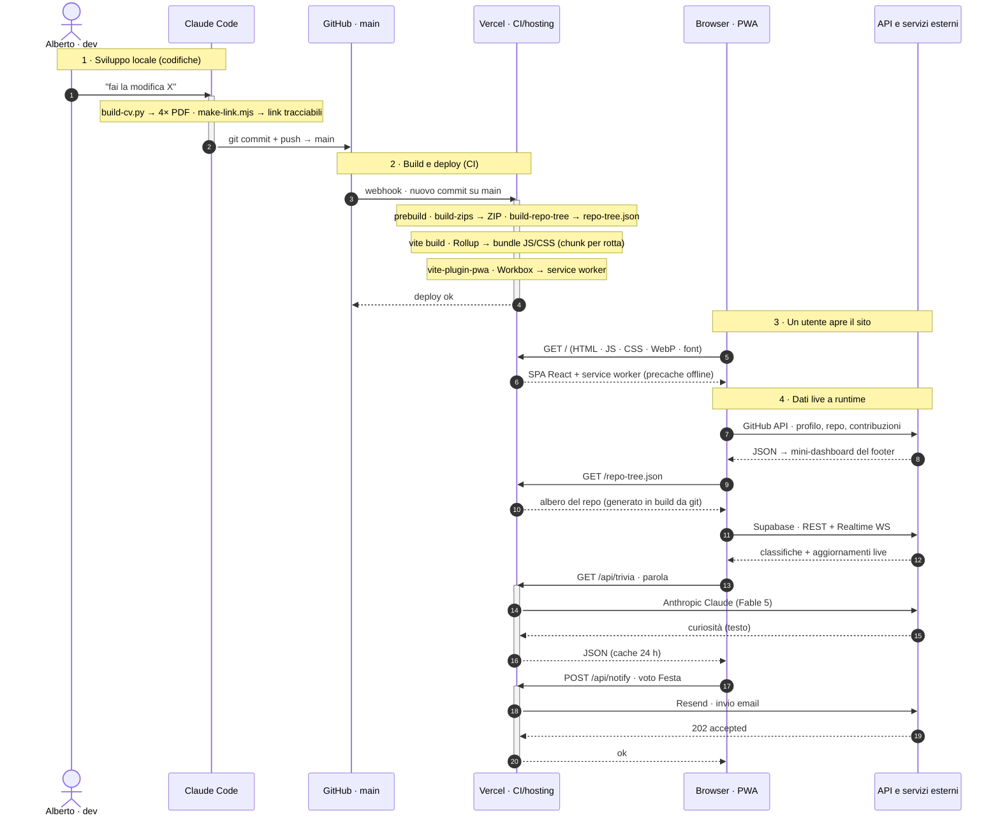

<div align="center">

# Alberto Pecchini — Portfolio & Personal Hub

**SPA React/TypeScript** — un portfolio personale che fa da _hub_ a un sito multi-pagina
(bio, approfondimenti, un gioco-quiz, strumenti e sezioni evento), servito **una pagina
= un sottodominio**, tradotto al volo in **4 lingue** e vestito con un design system
**«piattaforma»** — la grammatica `.sb-` rifatta sulla homepage di Supabase, verde brand
e tema chiaro/scuro nativo.

<!-- ─────────────  METRICHE LIVE (shields.io → GitHub API, auto-aggiornanti)  ───────────── -->

[](https://github.com/albertoxpecchini/AP/commits/main)
[](https://github.com/albertoxpecchini/AP/pulse)
[](https://github.com/albertoxpecchini/AP)
[](https://github.com/albertoxpecchini/AP)
[](https://github.com/albertoxpecchini/AP)
[](https://github.com/albertoxpecchini/AP)
[](https://github.com/albertoxpecchini/AP/tree/main/src)
[](#-licenza)

> ⚠️ Il repository è **privato**: i badge qui sopra (e le API GitHub in generale) rispondono
> solo a chi ha accesso. Per questo il sito **non** interroga più `api.github.com` per l'albero
> dei file — se lo genera da `git` in fase di build (vedi [Archivio](#-archivio--lalbero-vero-del-repository)).

<!-- ─────────────  STACK (badge logo statici, allineati al package.json)  ───────────── -->

[](https://react.dev)
[](https://www.typescriptlang.org)
[](https://vite.dev)
[](https://tailwindcss.com)
[](https://reactrouter.com)
[](https://gsap.com)
[](https://vite-pwa-org.netlify.app/)
[](https://supabase.com)
[](https://www.anthropic.com)
[](https://vercel.com)

🔗 **Live:** [albertopecchini.it](https://albertopecchini.it) · **Repo:** [albertoxpecchini/AP](https://github.com/albertoxpecchini/AP) · **Autore:** [@albertoxpecchini](https://github.com/albertoxpecchini)

</div>

---

## 📊 Il progetto in numeri

> I badge di metrica derivano dall'API GitHub e si ricalcolano a ogni `git push`.
> La tabella qui sotto è misurata sull'albero versionato al momento della scrittura.

| Dominio | Valore | Dettaglio |
| :--- | :--- | :--- |
| **Codebase** | **~31,6k LOC** in `src/` | 93 file: 40 `.tsx` (17,6k) · 32 `.ts` (4,9k) · 21 `.css` (9,2k) |
| **Backend + tooling** | **~1,8k LOC** fuori da `src/` | 7 funzioni `api/` + `lib/` (889) · `scripts/` (893) |
| **Dipendenze** | **13 runtime** + 9 dev | niente framework pesanti, tutto essenziale |
| **Pagine** | **11 rotte** | 1 hub + 10 pagine `React.lazy`, code-split per rotta |
| **Lingue UI** | **4** — IT · EN · FR · DE | motore i18n che traduce il DOM live · 1011 voci generate |
| **Trivia — quiz** | **1003 domande** su 40 capitoli | 401 multipla · 401 vero/falso · 201 aperta |
| **Serverless** | **7 funzioni** in `api/` | trivia · notify · festa-rsvp · sponsor · ig-stats · d · cron |
| **Cronologia** | **336 commit** dal 2026-05-24 | 165 `feat` · 78 `fix` · 25 `style` · 15 `chore` · 6 `refactor` |

---

## 🎨 Il design system «piattaforma» (`.sb-`)

Il sito è stato **rifatto da zero sul layout della homepage di Supabase** e adattato ai contenuti
esistenti. Non è un tema applicato sopra: è la grammatica strutturale (nav sottile, hero a due
colonne, griglia prodotti a 12 colonne con card a bordo-gradiente, pannello «dashboard», switcher
dello stack con codice vero, story-card, muro community, sezione open source, CTA finale) portata
su ogni pagina.

- **Prefisso `.sb-`** — tutti i token e le classi vivono in [`src/app/home.css`](src/app/home.css) (1528 righe),
  ereditati da footer, ControlBar, archivio e pagine interne.
- **Tema chiaro/scuro NATIVO** — non due fogli di stile, ma un set di custom properties ridichiarate
  sotto `html.dark`. Il chiaro è il default.
- **Palette neutra + un solo colore** — grigi puri per fondali, bordi e testo; l'unica tinta è il
  **verde brand `hsl(153 60% 53%)`**. Dal 2026-08 è l'unico accento su **tutte** le pagine:
  l'arancio Ubuntu sopravvive solo nelle email transazionali (`api/d.ts`).
- **Un fondale solo, per tutta la pagina** — `.sb-bg` è `position: fixed`: due velature radiali
  (verde e ciano) e una griglia tecnica che si dissolve verso il basso, incollate alla finestra.
  Nessun bordo di sezione può tagliarlo mentre si scorre, quindi **fra una sezione e l'altra non
  c'è nessun confine**; il contenuto scorre sopra, trasparente. Anche il footer non comincia con un
  bordo: il suo colore entra in **dissolvenza** dall'alto.
- **Tipografia Titillium Web** — il carattere del sito (+ Roboto Mono per il codice; Lora solo per `/festa`),
  al posto del Circular di Supabase.
- **CSS per pagina** — ogni pagina ha il suo file accanto al componente
  (`bio.css`, `pcto.css`, `mestesso.css`, `instagram.css`, `sostieni.css`, `trivia.css`,
  `archivio.css`, `controlbar.css`, `palette.css`, `scrollprogress.css`, `workflow.css`, più
  `approfondimento.css` condiviso da `/dubliners` e `/gattopardo`), importato
  dal componente stesso: nessun foglio monolitico, e il code-splitting per rotta porta con sé anche
  lo stile.

**La palette per intero è consultabile dal sito**: footer → **«Palette»**
([`PaletteModal.tsx`](src/app/site/PaletteModal.tsx)) apre una finestra con tutte le tinte in uso —
verde brand, fondali, bordi, testo (con rapporto di contrasto), colori del codice, token shadcn,
grafico contribuzioni, linguaggi, i pochi colori fissi di Trivia, arancio delle email — mostrate
**nei due temi affiancati** e copiabili negli appunti.

---

## 🧩 La chrome globale — montata una volta, viva ovunque

Tre elementi stanno **fuori dal router**, in [`src/main.tsx`](src/main.tsx), e accompagnano ogni pagina:

| Componente | Dove | Cosa fa |
| :--- | :--- | :--- |
| **ControlBar** — [`theme/ControlBar.tsx`](src/app/theme/ControlBar.tsx) | in basso a sinistra | Un'unica pillola: **lingua · tema · sensore orario**. Sta rincantucciata oltre il bordo e lascia sporgere solo la linguetta; esce quando il puntatore le si **avvicina** (130 px), quando il fuoco da tastiera entra, o premendo la linguetta (unico modo sul touch, dove resta fissata). Rientra da sola dopo 620 ms, ma solo se non è sotto il puntatore, non ha il fuoco e non ha menu aperti. |
| **ScrollProgress** — [`site/ScrollProgress.tsx`](src/app/site/ScrollProgress.tsx) | bordo alto | Il filo di avanzamento della lettura. Non usa `ScrollTrigger` (le pagine sono lazy e cambiano altezza dopo il montaggio): rimisura a ogni frame utile e ammorbidisce con `gsap.quickTo`. Con lo scroll bloccato (modali) si **congela** invece di azzerarsi. |
| **SpeedInsights** — `@vercel/speed-insights` | invisibile | Core Web Vitals reali, solo in produzione. |

Il **tema globale** ([`theme/themeCore.ts`](src/app/theme/themeCore.ts)) ha una sola fonte di verità:
in modalità `auto` segue un **sensore orario** (08:00–19:59 chiaro, il resto scuro, con transizione
animata che parte un secondo prima del confine); in `manual` vince il tasto **fino al confine orario
successivo**, poi il sensore riprende il comando. Il tema si riflette su `<html>` (`.dark` +
`data-ap-theme`) e resta allineato ai meccanismi già esistenti dei giochi e di `/me-stesso`.

---

## 🌀 Movimento — GSAP, e soprattutto quello che è stato tolto

Il sito ha attraversato una fase in cui **ogni blocco si annunciava**: reveal a cascata allo scroll,
riflessi che seguivano il puntatore dentro i pannelli, lampi in diagonale all'ingresso nelle card,
alone della hero con inerzia, e una manciata di loop CSS infiniti (sheen dei bottoni, aurora, deriva
della griglia, shimmer degli scheletri, lancetta). **È stato quasi tutto rimosso**, con la
motivazione scritta nel codice dove stava l'effetto:

> Ogni blocco entrava in scena da opacità 0 salendo di una ventina di pixel: scendendo piano si
> vedeva la pagina «ricaricarsi» un blocco alla volta, con quella dissolvenza chiara che faceva
> sembrare lo scroll a scatti. Il contenuto adesso c'è e basta — **scorrere una pagina non è un
> evento da annunciare.**

Quel che resta è diviso per responsabilità, non sparso nei componenti:

- [`site/homeMotion.ts`](src/app/site/homeMotion.ts) — regia della home. Restano l'**intro della
  hero** (una timeline sola, che parte al caricamento) e i **contatori** che si accendono arrivando
  a vista. Nessun reveal allo scroll.
- [`site/footMotion.ts`](src/app/site/footMotion.ts) — regia **separata** del footer, perché il footer
  vive su ogni pagina e deve funzionare anche in fondo a Trivia o all'archivio (sulla home i suoi
  elementi sono esclusi a mano da `homeMotion`, così a comandare è sempre un file solo). Restano i
  contatori — armati da un `MutationObserver`, perché i numeri del widget GitHub arrivano dalla rete
  **dopo** il montaggio — e i **magneti**: card, icone social e chip che si sporgono al massimo di
  7 px verso il cursore, con un solo ascoltatore in delega su tutto il footer.
- [`site/homeLive.tsx`](src/app/site/homeLive.tsx) — le **sette tavole** della griglia prodotti.
  Erano sette miniature di interfaccia (finestra di browser, terminale che digita, tabellone di
  gioco, cubo su un piano); adesso sono sette **disegni a tratto** sulla stessa tavola di 280×132,
  stesso spessore di linea e stesso verde — il progetto quotato di una pagina, un saggio
  tipografico, un prisma che apre un raggio in cinque, una traiettoria a tre rimbalzi, due insiemi
  e la loro intersezione, un globo con due satelliti, le curve di livello di un rilievo. Da lontano
  si legge una collezione, non sette schermate. Una sola cosa in movimento per riquadro, e il
  movimento sta **tutto in CSS**: qui dentro non è rimasta una riga di JavaScript di animazione.
- [`site/ScrollProgress.tsx`](src/app/site/ScrollProgress.tsx) — l'avanzamento della lettura. Prima
  cresceva sul filo del footer, cioè si vedeva **solo una volta arrivati in fondo**, quando non
  serviva più; ora sta in cima alla finestra, su ogni pagina. È l'unica cosa che **resta accesa
  anche con `prefers-reduced-motion`** (senza inerzia): è informazione sulla pagina, e a muoverla
  è lo scroll dell'utente.
- `gsap.matchMedia()` ovunque: **`prefers-reduced-motion` spegne ogni movimento autonomo**, e gli
  effetti da puntatore si montano solo con `(hover: hover) and (pointer: fine)`. Tutto si smonta con
  `mm.revert()` — niente doppioni al cambio pagina.
- Regola ferrea: **niente split del testo traducibile** — il motore i18n cammina sui nodi di testo
  e trovarsi uno `<span>` per lettera lo manderebbe fuori strada.

---

## 🧭 Architettura a sottodomini — le pagine

Ogni pagina è un sotto-applicativo autonomo: **rotta dedicata**, **_lazy chunk_ indipendente**,
CSS proprio. In produzione vale la regola **una pagina = un sottodominio**
(`bio.albertopecchini.it`, `trivia.albertopecchini.it`, …) e la pagina è servita **alla root del
sottodominio**, senza redirect né path aggiunto; in dev/preview resta una SPA a path su un'unica
origine. La logica sta in [`src/app/site/nav.tsx`](src/app/site/nav.tsx): `<SiteLink>` è un drop-in
di `<Link>` che in produzione diventa un `<a>` cross-origin e in locale resta React Router.
I redirect `www → sottodominio` sono in [`vercel.json`](vercel.json).

| Rotta | Sottodominio | Pagina | Cosa fa |
| :--- | :--- | :--- | :--- |
| `/` | `www` | **Home / hub** | Vetrina «piattaforma»: hero, prodotti, archivio incorporato, stack, pagine, lavori, curriculum, open source, contatti |
| `/bio` | `bio` | **Bio** | Pagina About: gallery + fatti essenziali |
| `/trivia` | `trivia` | **Trivia** | Quiz sulla storia dell'architettura — 1003 domande, leaderboard, curiosità AI |
| `/pcto` | `pcto` | **PCTO** | Alternanza scuola-lavoro (Caem Group) — timeline + racconto |
| `/me-stesso` | `me-stesso` | **Me stesso** | Presentazione personale (Esame di Stato 2026) |
| `/dubliners` | `dubliners` | **Dubliners** | Approfondimento «Gente di Dublino» (J. Joyce, 1914) |
| `/gattopardo` | `gattopardo` | **Gattopardo** | Approfondimento «Il Gattopardo» (Tomasi di Lampedusa, 1958) |
| `/festa` | `festa` | **Festa** | Inviti con token, RSVP e notifica email |
| `/archivio` | `archivio` | **Archivio** | Esploratore di progetti **e dell'albero vero del repo** |
| `/sostieni` | `sostieni` | **Sostieni** | Dati bonifico + libro firme dei donatori |
| `/instagram` | _(solo path)_ | **Compare Two Lists** | «Chi ti ha tolto il follow» — confronto di due liste, tutto in locale |

---

## 🗃️ Archivio — l'albero vero del repository

`/archivio` è un **esploratore di file** in veste piattaforma: side-nav delle posizioni, barra
strumenti, tabella o griglia, preferiti, menu contestuali (Radix) e finestra **Proprietà** con
README. `<ArchivioExplorer/>` è riusabile: la pagina lo pilota per intero, la home lo incorpora
in versione `embedded` come «dashboard».

Oltre ai progetti mostra il **codice sorgente reale**, e qui sta il pezzo interessante:

> **Perché non le API di GitHub.** Il repository è **privato**: `api.github.com` risponde `404`
> senza token, e un token nel front-end non si mette.

La soluzione è [`scripts/build-repo-tree.mjs`](scripts/build-repo-tree.mjs), che gira in `prebuild`
(quindi **anche su Vercel, a ogni commit deployato**) e scrive `public/repo-tree.json` — artefatto
rigenerabile, fuori dal versionamento:

- `git ls-files` → **esattamente** i file versionati, `.gitignore` incluso;
- dimensione reale di ogni file (`statSync`) e **data dell'ultimo commit che l'ha toccato**,
  ricavata in **una sola passata** su `git log --name-only`;
- metadati del commit corrente (sha, messaggio, autore, data, conteggio) e branch;
- i cloni **shallow** della CI vengono prima completati con `--unshallow`; se non si può, il JSON
  lo dichiara (`"history": "shallow"`) e le date mancanti ripiegano su quella del commit corrente;
- se `git` non c'è, lo script **non blocca la build**: avvisa e basta, e l'archivio nasconde la sezione.

Lato client [`site/repoTree.ts`](src/app/site/repoTree.ts) trasforma il JSON in albero navigabile
(cartelle che aggregano byte, date e conteggi dei figli) con link a file, storia e commit su GitHub.

---

## 🧠 Trivia — il modulo di punta

Pipeline **content-driven, zero-config**: i capitoli sono file Markdown in [`content/trivia/`](content/trivia/),
importati a build-time via `import.meta.glob(..., { query: '?raw', eager: true })` e parsati una sola
volta in [`parseTrivia.ts`](src/app/trivia/parseTrivia.ts). Aggiungere un capitolo = aggiungere un `.md`;
nessun codice da toccare, nessun registro da aggiornare.

- **40 capitoli** ordinati dal campo `ordine:` (fallback alfabetico).
- **1003 domande** tipizzate: `multipla` (401), `vero-falso` (401), `aperta` (201), ognuna con
  spiegazione facoltativa, sinonimi accettati (`accetta:`) e foto.
- **Versionamento automatico** — `__TRIVIA_VERSION__` è iniettata da [`vite.config.ts`](vite.config.ts) come
  `1.<git rev-list --count HEAD -- src/app/trivia/>`: ogni deploy che tocca il modulo incrementa la _minor_ da solo.
- **Arricchimento AI** — l'endpoint serverless [`/api/trivia`](api/trivia.ts) interroga **Claude Fable 5**
  (`@anthropic-ai/sdk`) per curiosità contestuali; accetta solo richieste dal sito (origin check +
  rate-limit), così non è usabile come proxy AI gratuito. In dev lo stesso endpoint è servito da un
  middleware di Vite, con la chiave letta dal `.env`.
- Punteggio con bonus velocità, serie con trofei, voto finale in stile americano (A–F), pagelle e
  classifica **live** (Supabase Realtime, con fallback `localStorage`).

---

## 🌍 i18n — traduzione del DOM al volo

Invece di internazionalizzare undici pagine una per una, il sito **traduce il testo già renderizzato**
([`i18n/translateDom.ts`](src/app/i18n/translateDom.ts)):

- un `MutationObserver` segue ogni cambiamento del DOM (cambio rotta, chunk lazy, ri-render di React)
  e ritraduce nodi di testo e attributi (`placeholder`, `title`, `aria-label`, `alt`);
- per ogni nodo si tengono **originale** e **ultimo valore scritto da noi**: se il valore attuale non
  è il nostro, ha riscritto React → quello diventa il nuovo originale (gestisce i testi dinamici);
- mentre scriviamo l'observer è **scollegato** (niente loop infiniti) e tutto è raggruppato in un
  solo passo per frame;
- la **chiave** del dizionario è il testo sorgente normalizzato — la home è in inglese, giochi e
  approfondimenti in italiano — e il valore elenca **solo** le altre lingue: la sorgente è il fallback.
  `SCRIPT`, `STYLE`, `TEXTAREA`, `CODE`, `PRE` e i nodi `data-no-i18n` non si toccano mai.

Dizionario: [`dictionary.ts`](src/app/i18n/dictionary.ts) (voci curate a mano) + **1010 voci** in
[`translations.json`](src/app/i18n/translations.json). Cambiare lingua non ricarica la pagina.

---

## 🗂️ Struttura del repository

```
AP/
├── api/                      # 7 funzioni serverless Vercel (Node)
│   ├── trivia.ts             #   curiosità AI (Claude Fable 5)
│   ├── notify.ts             #   email dei voti Festa (Resend)
│   ├── festa-rsvp.ts         #   scrittura RSVP blindata (service role)
│   ├── sponsor.ts            #   firma libro donatori blindata
│   ├── ig-stats.ts           #   contatore confronti Instagram
│   ├── d.ts                  #   link tracciabili: apertura + redirect + autodelete
│   └── cron-cleanup.ts       #   pulizia giornaliera dei link scaduti (cron)
├── content/trivia/           # 40 capitoli .md → fonte unica delle domande Trivia
├── email/                    # modello email HTML (le bozze NON si committano)
├── lib/serverSecurity.ts     # helper condivisi: origin check, rate-limit, diagnostica
├── public/                   # PDF (CV in 4 lingue + attestati), immagini, manifest PWA
├── scripts/
│   ├── build-cv.py           #   src/app/cv/data/*.json → 4 PDF statici (WeasyPrint)
│   ├── build-zips.mjs        #   ZIP del sorgente per ogni progetto d'archivio
│   ├── build-repo-tree.mjs   #   albero del repo da git → public/repo-tree.json
│   ├── make-link.mjs         #   link tracciabili usa-e-getta (solo in locale)
│   └── seed-*.js|.mjs        #   seed dei profili
├── src/
│   ├── app/
│   │   ├── App.tsx           # Home «piattaforma» + header/menu inline
│   │   ├── home.css          # il design system .sb- (token, layout, loop CSS)
│   │   ├── site/             # footer, nav, dati, progetti, README dei progetti,
│   │   │                     #   homeIcons/homeLive/homeMotion/footMotion,
│   │   │                     #   repoTree, PaletteModal, ScrollProgress,
│   │   │                     #   WorkflowModal + workflow.css (diagramma in CSS)
│   │   ├── cv/               # /cv: il curriculum come pagina (4 lingue) + stampa
│   │   │                     #   PDF; data/cv.<lingua>.json = fonte unica, la
│   │   │                     #   legge anche scripts/build-cv.py
│   │   ├── theme/            # ControlBar (lingua·tema·sensore) + themeCore
│   │   ├── trivia/           # gioco quiz + parser + API leaderboard/pagelle/progressi
│   │   ├── bio  pcto  me-stesso  dubliners  gattopardo  festa  archivio  sostieni  instagram
│   │   ├── i18n/             # motore di traduzione del DOM (IT · EN · FR · DE)
│   │   ├── utils/            # keyboard guard, scroll lock, device, prefs
│   │   └── _game/            # motore condiviso dei giochi (gate, tokens, leaderboard)
│   ├── lib/                  # utilità trasversali (players)
│   └── styles/               # theme.css · tailwind · fonts · ios · site · ubuntu
├── supabase/                 # schema .sql delle tabelle (scores, grades, players, link)
└── vite.config.ts            # plugin React/Tailwind/PWA, asset resolver, versioning, dev-API
```

---

## 🔀 Come funziona — il giro dei dati (dal codice all'online)

Dalla **sorgente** (testi, dati, immagini, codice) agli **artefatti** prodotti dagli script di build
(PDF · ZIP · `repo-tree.json` · bundle · service worker), fino al **deploy** su Vercel e ai **dati live**
che il browser richiede a runtime (GitHub, Supabase, `/api`).

> **Lo stesso schema è consultabile dal sito**: footer → **«Come funziona»**
> ([`WorkflowModal.tsx`](src/app/site/WorkflowModal.tsx)). Qui sotto è un blocco `mermaid`, che
> GitHub renderizza da sé; **il sito però non usa Mermaid**. Il diagramma di sequenza è disegnato
> a mano con una griglia CSS (`.apw-`, [`workflow.css`](src/app/site/workflow.css)): una colonna per
> partecipante, linea di vita tratteggiata, barra di attività verde, messaggi che scavalcano le
> colonne. Così segue il tema chiaro/scuro del sito, parla tutte e 4 le lingue, e **sotto i 780 px
> diventa un elenco di passi** — con lo stesso markup, è React a deciderlo via `matchMedia`.
> Il vantaggio vero: non si porta dietro una libreria intera per un solo diagramma.



| Servizio esterno | Uso | Dove |
| :--- | :--- | :--- |
| **GitHub API** (pubblica) | profilo, repo aggregati, linguaggi nel footer | client (cache 60 min) |
| **jogruber `github-contributions-api`** | grafico contribuzioni reale, senza token | client |
| **Supabase** (REST + Realtime WS) | classifiche, pagelle, progressi, presenze, libro donatori, link tracciabili (fallback `localStorage`) | client + serverless |
| **Anthropic Claude** (Fable 5) | curiosità del gioco Trivia | serverless `/api/trivia` |
| **Resend** | email dei voti Festa + avviso di apertura link tracciabili | serverless `/api/notify`, `/api/d` |

---

## 🧰 Stack tecnologico

| Layer | Tecnologie |
| :--- | :--- |
| **Core** | React 18.3 · TypeScript · Vite 6.3 |
| **Routing** | `react-router` 7 (BrowserRouter, `lazy` + `Suspense`) + mappa host → pagina per i sottodomini |
| **Styling** | design system `.sb-` in CSS puro (custom properties, tema nativo) · Tailwind CSS 4.1 · `tw-animate-css` |
| **Motion** | `gsap` 3.15 + ScrollTrigger (intro della hero, contatori, magneti, filo di lettura, tilt del vetro) · keyframe CSS per le sette tavole della griglia prodotti · `canvas-confetti` in Trivia |
| **UI** | icone `homeIcons.tsx` disegnate a mano (outline 24×24, tratto 1.5) · `lucide-react` + `react-icons` dove serve · `@radix-ui/react-context-menu` (archivio) · diagrammi disegnati in CSS, senza librerie |
| **i18n** | motore proprietario che traduce il DOM in IT · EN · FR · DE |
| **PWA** | `vite-plugin-pwa` + Workbox (precache offline, auto-update) |
| **Backend** | Supabase via REST/Realtime · 7 funzioni serverless Vercel + `lib/serverSecurity` |
| **AI** | `@anthropic-ai/sdk` → Claude Fable 5 (curiosità Trivia) |
| **Insight** | `@vercel/speed-insights` (Core Web Vitals reali) |
| **Tooling** | `build-cv.py` (WeasyPrint → 4 PDF) · `archiver` per gli ZIP · `build-repo-tree.mjs` per l'albero |

> **Peso del primo accesso.** Quattro cose che il browser scaricava e non guardava:
>
> - **maplibre-gl** (~275 kB gzip) partiva col resto della home. `React.lazy` è pigro rispetto al
>   *render*, non allo *scroll*: la mappina in fondo veniva renderizzata al primo frame come tutto
>   il resto, quindi il suo `import()` partiva subito. Adesso passa da
>   [`WhenVisible`](src/app/site/WhenVisible.tsx) e si scarica quando ci si avvicina.
> - **Le traduzioni** erano 230 kB di JSON con dentro tutte e quattro le lingue, importati in cima
>   a `dictionary.ts`. `build-i18n.mjs` li spacchetta in quattro pacchetti e se ne carica **uno**,
>   quello attivo.
> - **Framer Motion** (~40 kB gzip) stava nel bundle di ogni pagina per animare il menu a tendina
>   della lingua. Le sue tre animazioni sono tre transizioni CSS.
> - **`three`, `vanta`, `mermaid`, `motion`**: rimasti in `package.json` dopo essere spariti dal
>   codice. Disinstallati.
>
> Risultato: **−63 % sul percorso critico della home** (638 → 238 kB gzip) e **precache del service
> worker da 2,9 MB a 1,3 MB**, con `vendor-react` e `vendor-gsap` in chunk separati — così un
> commit sul sito non obbliga a riscaricare anche le librerie.

---

## 🔐 Sicurezza & privacy

Il sito è pensato per essere **a prova di abuso**, senza archiviare dati di terzi.

- **Solo l'email è pubblica** — niente telefono né WhatsApp sul sito o nel CV.
- **Scritture blindate** — RSVP, firme donatori e contatori non partono diretti dal client verso
  Supabase: passano da un endpoint serverless con **origin check + rate-limit** e `INSERT` con
  **service role** (la `anon key` non può iniettare dati fasulli). Le letture restano pubbliche.
- **Nessun token GitHub nel front-end** — il repo è privato e l'albero dei file arriva da `git` in
  build, non da un'API autenticata.
- **Link tracciabili usa-e-getta** — [`/api/d`](api/d.ts) apre, conta e reindirizza; **autodelete a 7 giorni**
  (cron [`/api/cron-cleanup`](api/cron-cleanup.ts), protetto da `CRON_SECRET`), avviso via email alla
  **prima apertura**. I link si creano **solo in locale** con [`make-link.mjs`](scripts/make-link.mjs) —
  nessun endpoint pubblico, meno superficie d'attacco. La diagnostica del «chi» (IP, device, area)
  finisce **solo nell'email**, mai archiviata.
- **Header di sicurezza + CSP** in [`vercel.json`](vercel.json): CSP con allow-list esplicita delle
  origini `connect-src`, HSTS 2 anni, `X-Frame-Options: DENY`, `Permissions-Policy` che spegne
  camera/microfono/geolocalizzazione/pagamenti, COOP `same-origin`.

---

## 🚀 Getting started

**Requisiti:** Node ≥ 18 (`npm`, `pnpm` o `yarn`). Per rigenerare i CV serve anche Python con
**WeasyPrint** e il font **Ubuntu** installato a sistema.

```bash
git clone https://github.com/albertoxpecchini/AP.git && cd AP
npm install
npm run dev       # http://localhost:5173 — HMR attivo, middleware /api/*
npm run build     # bundle di produzione in dist/ (prima: prebuild → ZIP + repo-tree)
```

Le chiavi vivono in un `.env` locale (non versionato, e **non** c'è un `.env.example` nel repo):
`ANTHROPIC_API_KEY` per le curiosità di Trivia, `VITE_SUPABASE_URL` + `VITE_SUPABASE_ANON_KEY`
per le letture dal client, `SUPABASE_SERVICE_ROLE_KEY` per gli endpoint blindati e i link
tracciabili, `RESEND_API_KEY` per le email, `CRON_SECRET` per il cron.

| Comando | Azione |
| :--- | :--- |
| `npm run dev` | Dev server Vite + middleware `/api/*` (porta 5173) |
| `npm run build` | Build statica in `dist/` (`prebuild` → ZIP + `repo-tree.json`, poi `vite build`) |
| `npm run zips` | Rigenera solo `public/zips/` + il manifest delle dimensioni |
| `npm run repo-tree` | Rigenera solo `public/repo-tree.json` dall'albero git |
| `python3 scripts/build-cv.py [it en fr de]` | Rigenera i PDF statici del CV da `src/app/cv/data/` (il CV "vivo" è la pagina `/cv`, che stampa sé stessa) |
| `npm run pulizia` | Cerca lo sporco e misura, **senza toccare niente** |
| `npm run pulizia:applica` | Pulisce, verifica con build + benchmark, annulla da solo se qualcosa peggiora |
| `npm run bench` | Solo benchmark: build, peso, fotogrammi — confrontati con l'ultima volta |
| `npm run pulizia:prove` | Le prove di sicurezza del programma di pulizia (pianta file veri e controlla cosa decide) |

---

## 🧹 Pulizia e benchmark — `scripts/janitor/`

Un programma locale che ogni due giorni toglie il peso morto dal repo e **dimostra** di non
aver rotto niente. Non è un `rm -rf` con un cron davanti: la parte interessante è tutta nel
come si assicura di poter girare da solo senza sorveglianza.

**Niente viene cancellato.** Quello che sembra inutile finisce in `.janitor/quarantena/<data>/`
con i percorsi originali intatti, poi la build gira davvero, poi un browser vero apre le pagine
davvero. Se la build non passa, o se compare un 404 che prima non c'era, o un errore in console
che prima non c'era, **tutto torna al suo posto da solo**. Il caso peggiore di un'esecuzione
automatica è un log che dice "annullato". Solo le quarantene sopravvissute a due settimane di
sito funzionante vengono svuotate per davvero.

**Cosa cerca** — sei categorie, e nel dubbio non è sporco:

| | Cosa | Come lo decide |
| :--- | :--- | :--- |
| 1 | Rigenerabili | `dist`, cache di Vite, log: già in `.gitignore` e ricostruiti da uno script dichiarato in `package.json` |
| 2 | Moduli orfani in `src/` | Irraggiungibili dal grafo degli import **e** mai nominati in nessun testo del repo — due prove indipendenti |
| 3 | Asset mai nominati in `public/` | Nessun file cita il percorso né il nome |
| 4 | Dipendenze mai importate | Nessun `import`, nessuna menzione |
| 5 | Duplicati esatti | Stesso SHA-1 in due percorsi — **solo segnalati**: quale sia quello buono non lo può sapere il programma |
| 6 | Git | `git gc`, rami già confluiti in `main` |

Le radici del grafo sono larghe di proposito (`index.html`, ogni file in `api/`, ogni script,
`vite.config.ts`): una radice dimenticata renderebbe "orfano" un ramo di codice vivo. E le
cartelle indirizzate a runtime — `/emoji/`, `/models/tex/`, `/zips/${slug}` — sono protette in
blocco, perché il loro contenuto non compare mai per esteso nel codice e cercarlo per nome darebbe
zero riscontri su file usatissimi.

**L'ordine conta.** I rigenerabili si tolgono **dopo** la verifica, non prima: messi all'inizio,
la build di verifica li ricreava tutti e il bilancio finale diceva onestamente `+0.0 MB`. Tolti
alla fine, la verifica è comunque avvenuta su un albero completo e lo spazio resta libero davvero.
Restano invece al loro posto `public/zips`, `repo-tree.json` e i pacchetti i18n (~440 kB): li rifà
il `prebuild`, che gira su `npm run build` ma **non** su `npm run dev`, e portarli via ogni due
giorni vorrebbe dire trovare `/archivio` senza ZIP da scaricare. Con `--tutto` se ne vanno anche
quelli. Il bilancio distingue sempre il risparmio **definitivo** (git, file del progetto) da
`dist` e cache, che tornano alla prima ricostruzione: spazio prestato, non guadagnato.

**La storia git non si riscrive mai.** `git gc` compatta e basta: servirebbe un push forzato, e un
push forzato automatico ogni due giorni è esattamente il modo di rompere tutto.

### Il benchmark

Un browser vero (Edge, via Chrome DevTools Protocol) apre le pagine costruite, le scorre tutte giù
e tutte su, e cronometra ogni singolo fotogramma. **Zero dipendenze aggiunte**: sarebbe assurdo
installare quaranta megabyte di Playwright dentro il programma che serve a togliere peso — Node ha
`WebSocket` di suo, e il protocollo si parla direttamente.

Si misura **due volte**, perché rispondono a due domande diverse:

- **a piena potenza** → "su questo computer siamo a 60?"
- **con la CPU 4× più lenta** → "e su un telefono di fascia media? e se domani qualcosa peggiora,
  me ne accorgo?"

La seconda non è un vezzo. Senza freno la misura **satura**: il browser non disegna oltre ~160 fps,
e una pagina vuota segna gli stessi fps di una pagina piena — verificato, `about:blank` fa 154.
Tutto ciò che costa meno di ~6 ms a fotogramma finisce appiattito sullo stesso numero, e un
peggioramento del 50% resterebbe invisibile. È quindi la passata frenata quella su cui si fa il
confronto nel tempo, ed è l'unica che sappia distinguere.

Ogni pagina si misura più volte e si tiene la **mediana**: una passata sola, su una macchina che
nel frattempo fa altro, racconta il rumore e non il sito. Le misure si accumulano in
`.janitor/bench/`, così il peggioramento lento si vede il giorno stesso e non fra sei mesi.

### Ogni due giorni, da solo

```powershell
powershell -ExecutionPolicy Bypass -File scripts\janitor\pianifica.ps1            # registra
powershell -ExecutionPolicy Bypass -File scripts\janitor\pianifica.ps1 -Ora 09:30 # a un'altra ora
powershell -ExecutionPolicy Bypass -File scripts\janitor\pianifica.ps1 -Stato     # com'è andata
powershell -ExecutionPolicy Bypass -File scripts\janitor\pianifica.ps1 -Rimuovi   # toglilo
```

Compito dell'utente, non di sistema: niente diritti di amministratore, niente password da
conservare. Finestra del browser invisibile, log in `.janitor/log/` (si tengono gli ultimi 20).
Se il computer era spento a quell'ora recupera al primo avvio utile.

I numeri di un'esecuzione automatica **non** sono confrontabili con quelli di `npm run bench`
lanciato a mano: l'Utilità di pianificazione fa girare i compiti a priorità ridotta, e il browser
misura mentre il resto del computer lavora. Il confronto prima/dopo dentro la stessa esecuzione
resta valido — le due misure girano nello stesso turno, nelle stesse condizioni — ed è quello che
decide se la pulizia si tiene.

<details>
<summary><strong>Cinque trappole di Windows</strong> — costate care, tutte con lo stesso sintomo: "sembra che non faccia niente"</summary>

- **`.ps1` senza BOM.** PowerShell 5.1 legge i file senza BOM come ANSI. Il trattino lungo `—`
  (UTF-8 `E2 80 94`) diventa `â€"`, e quell'ultimo carattere è una virgoletta tipografica che
  PowerShell accetta come delimitatore di stringa: le virgolette vanno in disequilibrio e lo
  script muore segnalando una riga che non c'entra niente. I due `.ps1` vanno tenuti **UTF-8 con
  BOM**.
- **`*>&1` con `$ErrorActionPreference = 'Stop'`.** PowerShell incapsula ogni riga di stderr di un
  programma esterno in un `NativeCommandError`, che con `Stop` è un errore *terminante*: il
  compito moriva a metà log pur essendo andato tutto bene. Si redirige a livello di processo, con
  `Start-Process -RedirectStandardOutput`.
- **`Start-Process -Wait` aspetta l'albero, non il processo.** Il benchmark apre un browser: un
  solo processo di Edge rimasto indietro teneva il compito "In esecuzione" a tempo indeterminato,
  con node già uscito e il log completo. Serve `$proc.WaitForExit()`, che guarda solo il processo
  lanciato — e dall'altra parte `taskkill /T` per non lasciare indietro nessuno.
- **Codepage OEM.** L'uscita UTF-8 di node, catturata da PowerShell, veniva decodificata con la
  codepage della console: nel log `già` diventava `gi├á`. Risolta anche questa redirigendo a
  livello di processo. I colori ANSI, poi, in un file sono solo rumore: il programma li mette solo
  se dall'altra parte c'è un terminale vero.
- **`.ExitCode` vuoto senza `.Handle`.** `Start-Process -PassThru` senza `-Wait` restituisce un
  oggetto `Process` che non conserva l'handle nativo: a processo finito `.ExitCode` torna vuoto e
  un fallimento di node passerebbe per riuscito (nel log si leggeva `uscita  ===`). Basta leggere
  `$null = $proc.Handle` **prima** di aspettare. Verificato: senza, `''`; con, `3`.

</details>

Per rimettere a mano quello che è stato messo da parte: `npm run pulizia:ripristina`
(o `npm run pulizia:elenco` per vedere le quarantene).

### Da terminale — `pulizia`

Gli `npm run …` funzionano, ma sono scomodi da scrivere (e le opzioni vanno passate dopo un
`--`). Alla radice del repo c'è `pulizia.cmd`, porta d'ingresso unica:

| | |
| :--- | :--- |
| `pulizia` | guarda e riferisce, non tocca niente |
| `pulizia applica` | pulisce, verifica, e se serve annulla da solo |
| `pulizia bench` | solo benchmark |
| `pulizia prove` | le prove di sicurezza |
| `pulizia elenco` | le quarantene esistenti |
| `pulizia ripristina` | rimette a posto l'ultima quarantena |
| `pulizia pianifica` · `togli` · `stato` | il compito ogni due giorni |

Quello che scrivi in più passa dritto al programma — `pulizia applica --tutto --rami`,
`pulizia bench --veloce --pagine /,/trivia` — e un'opzione da sola vale come analisi, quindi
`pulizia --niente-bench` fa la cosa che ci si aspetta. Il codice di uscita si propaga, così si
può incatenare.

**PowerShell vuole il `.\`** — `.\pulizia applica` — perché di suo non esegue i file della
cartella corrente. Non è un difetto: senza quella regola basterebbe entrare in una cartella
qualsiasi perché un file chiamato come un comando noto venisse eseguito al posto suo. Per
scrivere `pulizia` e basta, da qualunque cartella, una funzione nel profilo (`$PROFILE`):

```powershell
function pulizia { & 'C:\Users\pzkko\Documents\AP\pulizia.cmd' @args }
```

Da `cmd.exe`, invece, `pulizia` funziona già così com'è dalla cartella del repo: il Prompt dei
comandi cerca anche nella directory corrente. E attenzione a non incollare i commenti insieme al
comando: `::` è un commento di cmd, in PowerShell diventa un argomento.

Due dettagli che sembrano pignoleria e non lo sono. Il file **deve** avere fine riga CRLF: con
LF soli, `cmd.exe` legge il file a offset sbagliati, i salti a etichetta atterrano a metà riga e
finisce per eseguire pezzi dei commenti come comandi (`"solo" non è riconosciuto come comando…`).
È bloccato in `.gitattributes`, perché il guaio si manifesta solo dopo un clone. E la codepage si
porta a UTF-8 per la durata del comando e si rimette com'era: a schermo non servirebbe — per una
console vera node converte in UTF-16 e chiama `WriteConsoleW`, quindi gli accenti escono giusti
anche a 850 — ma serve quando l'uscita viene rediretta, `pulizia > rapporto.txt`.

### `/cleaning` — l'officina, in pagina

`npm run dev` → **http://localhost:5173/cleaning**. Le stesse cose del terminale, ma con lo
sporco elencato, i lavori che si guardano mentre succedono, un editor per i file del repo e il
commit lì sotto.

Veste `.sb-` come il resto del sito, non uno stile a parte: stesso guscio (fondale unico fisso,
nav sottile con briciola che prende il bordo solo dopo lo scroll, sezioni trasparenti senza
divisori), stessi `.sb-btn` e `.sb-panel`, classi proprie col prefisso di pagina `.sb-cl-*`, e
**palette neutra più il solo verde del marchio** — niente rosso per gli errori né arancio per gli
avvisi: si distinguono per peso e bordo. Tema scuro nativo, perché i colori vengono tutti da
`var(--sb-*)` e `html.dark .sb-home` ridichiara gli stessi token.

- **Sporco trovato** — cinque pastiglie per il colpo d'occhio (un numero, o una spunta), e sotto
  si aprono solo le categorie che hanno qualcosa da dire. Le voci che la pulizia di default *non*
  porta via (le rifà solo il `prebuild`) sono in grigio e dichiarate: `resta, salvo --tutto`.
- **Lavori** — «Pulisci e verifica», «Benchmark», «Prove», «Solo analisi». Il log arriva
  **mentre succede**, riga per riga, via Server-Sent Events: la pulizia completa ci mette
  qualche minuto e guardarla lavorare è meglio che fissare uno spinner. Chiudere la scheda
  ferma il processo.
- **File** — filtra, apri, modifica, `Ctrl+S`. Un file con modifiche non salvate si dichiara, e
  chiedere di chiudere la scheda costa una domanda.
- **Commit** — i file cambiati con le spunte, il messaggio, commit e push.

**Non esiste in produzione, e non per una svista evitata.** Gli endpoint stanno in un plugin che
vive dentro `configureServer`, l'aggancio che gira solo con `vite dev`: in `vite build` non viene
nemmeno chiamato. La rotta è dietro `import.meta.env.DEV`, che rollup risolve a `false` e porta
via insieme all'`import()`. Verificato sul build vero: nessun chunk, nessuna stringa
`api/cleaning`, nessuna classe `.cl-` nei CSS, nessun testo della pagina. L'unica occorrenza di
`cleaning` in `dist/` sta in `repo-tree.json`, che elenca `src/app/cleaning/Cleaning.tsx` fra i
file del repository — è l'albero dei sorgenti che `/archivio` mostra apposta, cioè metadato che
dice «questo file esiste», non codice che gira.

La seconda difesa è sui percorsi: tutto quello che arriva dal browser passa da `dentroIlRepo()`,
che risolve e pretende che il risultato stia sotto la radice del repo. Senza, un
`?p=../../../../Windows/...` sarebbe bastato. `.git`, `node_modules` e i `.env` restano fuori
comunque, e si scrivono solo file di testo — un PDF riscritto come stringa UTF-8 sarebbe corrotto
in silenzio. Provato: traversal `400`, `.git` `400`, `.env` `400`, PDF `415`, e nessun file
comparso fuori dal repo.

Un dettaglio pratico: salvare `vite.config.ts` o qualcosa che lui importa fa **riavviare** il dev
server, quindi la pagina si ricarica e un lavoro in corso si interrompe. È Vite che fa il suo
mestiere, non un guasto.

### Che le prove le faccia il programma stesso

`npm run pulizia:prove` pianta file veri nel repo, guarda cosa decide l'analisi e rimette tutto
com'era. Sei prove, non simmetriche di proposito: due controllano che lo sporco venga **trovato**,
le altre che il pulito **non** venga toccato — un falso negativo costa qualche kB, un falso
positivo rompe una pagina.

I nomi dei file piantati sono casuali, e non è un vezzo: scritti per esteso nel file di test
passavano per il motivo sbagliato. L'analisi cerca il nome di un file in tutto il testo del repo,
e il file di test fa parte del repo — bastava nominarlo perché venisse dichiarato "citato da
qualche parte", quindi vivo. La prova sull'orfano falliva e quelle sulla protezione passavano
senza aver verificato niente.

**Nessun file esistente viene mai toccato.** La prova che un modulo *importato* non venga
scambiato per orfano infilava l'import in cima a `src/main.tsx` e lo toglieva alla fine. Regge
finché il processo muore con grazia — e su Windows non muore con grazia: `SIGTERM` non è un vero
segnale, il processo viene terminato e `finally` non gira. Siccome `/cleaning` lancia queste
prove come processo figlio e lo ammazza se chiudi la scheda, è successo davvero: in `main.tsx`
sono rimasti due import verso file appena cancellati, e l'app non partiva. Ora la catena
radice → modulo si costruisce con **due file piantati** (uno in `scripts/`, che è già una radice
del grafo), tutto usa e getta. In più: il marchio `__prova-janitor-` nel nome è in `.gitignore`,
così un residuo non può finire in un commit, ogni corsa spazza quelli lasciati dalle precedenti,
e se un repo si trascina ancora il danno vecchio in `main.tsx` viene riparato da solo.

---

## ♿ Accessibilità & 🚀 Deploy

**A11y:** skiplink al contenuto · landmark semantici (`main`/`nav[aria-label]`/`header`/`footer`) ·
`aria-labelledby` sui modali · focus visibile (`:focus-visible` con outline verde brand) ·
contrasto AA verificato nella finestra Palette · **`prefers-reduced-motion` onorato in tutta la
regia GSAP** · ControlBar raggiungibile da tastiera (esce al `focus`) ·
`Backspace` neutralizzato fuori dai campi testo (`disableBackspaceNavigation`).

**Deploy:** SPA statica → **Vercel** (`buildCommand: npm run build`, output `dist/`, branch `main`
= produzione), con funzioni serverless in `api/`, redirect `www → sottodominio`, rewrite di
`/d/:id` e un **cron** giornaliero alle 03:00 per la pulizia dei link.

---

## 🎨 Palette

Verde brand identico nei due temi, grigi puri intorno. L'arancio Ubuntu resta solo nelle email.
Tutto il sistema colore è documentato e copiabile dal sito (footer → **«Palette»**).

-3ECF8E?style=flat-square)


Carattere del sito: **Titillium Web** (+ Roboto Mono; Lora solo per `/festa`).

---

## 📄 Licenza

Codice sotto licenza **MIT** — liberamente riutilizzabile. Testi, foto personali, CV e brand
«Alberto Pecchini» sono **© Alberto Pecchini**, non riproducibili senza autorizzazione.

## 📬 Contatti

[](mailto:pzkko@yahoo.com)
[](https://github.com/albertoxpecchini)
[](https://www.instagram.com/albertoxpecchini)

<div align="center"><sub>Costruito con ❤️ a Mantova · <code>una pagina = un sottodominio</code></sub></div>
